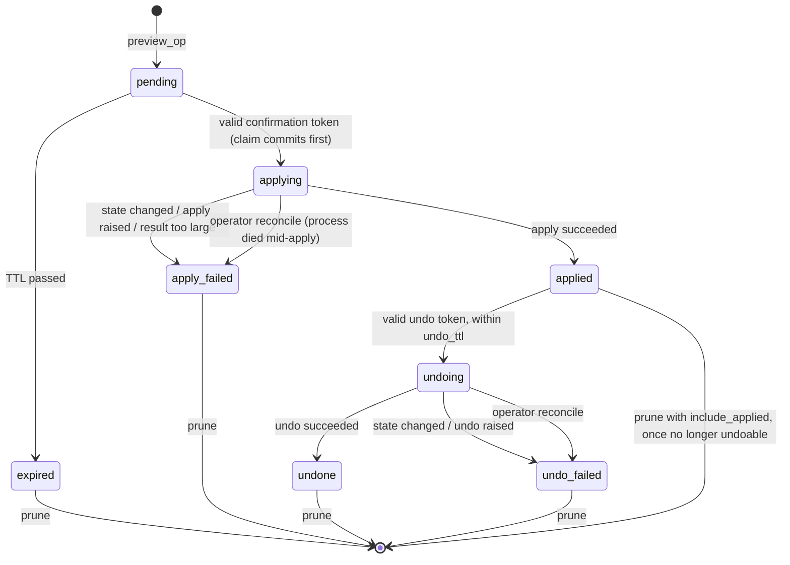

# mcp-changeset

[](https://github.com/GustavFredrikson/mcp-changeset/actions/workflows/ci.yml)

**Preview → apply → undo for state-changing MCP tools, with a durable SQLite
ledger.** An agent can propose changes freely. Running one requires a
single-use, expiring token for one stored payload, and the state the preview
saw is checked again before the write. Applied changes can be undone if you
give the operation an inverse. Every step is recorded in a local ledger that
is shared across processes and survives restarts.

It is a small library for **server authors**, built on the official
[MCP Python SDK](https://github.com/modelcontextprotocol/python-sdk)
(`FastMCP` in mcp 1.x, `MCPServer` in mcp 2.x). It is **not a security
layer**: it does not authenticate anyone, and by itself it does not prove that
a human approved anything (see [Threat model](#threat-model-and-non-goals)).
It complements the SDK's own confirmation mechanism rather than replacing it.

## Where it fits

MCP [2026-07-28](https://modelcontextprotocol.io/specification/2026-07-28/changelog)
introduced [Multi Round-Trip Requests](https://modelcontextprotocol.io/specification/2026-07-28/basic/patterns/mrtr)
(MRTR): a tool can return `input_required`, for example to ask the user to
confirm, and the client retries with the answer and an opaque `requestState`.
The spec says servers MUST treat that state as attacker-controlled. The Python
SDK 2.x installs a [`RequestStateBoundary`](https://github.com/modelcontextprotocol/python-sdk/blob/main/src/mcp/server/request_state.py)
on every `MCPServer` that seals the state (AES-256-GCM) and binds it to the
method, tool name, an argument digest, audience and principal, with a TTL. The
spec also says this does **not** make the state single-use, and that servers
needing at-most-once must enforce it themselves.

| | SDK 2.x MRTR + `RequestStateBoundary` | mcp-changeset |
| --- | --- | --- |
| Asks the **user** (not the model) | ✅ via elicitation | ❌ token goes to the agent; combine with MRTR for this |
| Approval bound to the call's arguments | ✅ argument digest | ✅ apply takes no data; runs the stored payload |
| Expiry | ✅ (default 10 min) | ✅ (default 15 min, bounds configurable) |
| Single use / at-most-once execution | ❌ by design, left to servers | ✅ SQLite claim before any write |
| Survives restarts / shared across processes | only with shared keys; nothing is recorded | ✅ one ledger file |
| Re-checks the target's state before writing | ❌ (only the tool can) | ✅ optional `observe` hook, also before undo |
| Undo | ❌ | ✅ optional compensation with its own token |
| Record of what ran | ❌ | ✅ local ledger rows (not tamper-evident) |
| Available on mcp 1.x | ❌ | ✅ |

[Composing the two](#composing-with-the-sdks-confirmation-flow) is shown below.

## 30-second quickstart

```console
$ pip install mcp-changeset   # not yet on PyPI; for now: pip install -e .
$ MCP_CHANGESET_WRITE_MODE=guarded python examples/notes_server.py
```

```python
from mcp.server.mcpserver import MCPServer  # mcp 1.x: from mcp.server.fastmcp import FastMCP
from mcp_changeset import ChangeError, Guard, Proposal, diff_fields

server = MCPServer("settings")
guard = Guard(server, ledger_path="~/.local/state/settings/ledger.db")
settings = {"theme": "light"}


def apply(payload):  # trusted code, never exposed as a tool
    previous = settings[payload["key"]]
    settings[payload["key"]] = payload["value"]
    return {"previous": previous}


def undo(payload, result):
    settings[payload["key"]] = result["previous"]


@guard.guarded(apply=apply, undo=undo, observe=lambda p: settings.get(p["key"]))
def set_setting(key: str, value: str) -> Proposal:
    """Change a setting."""  # registered as preview_set_setting
    if key not in settings:
        raise ChangeError(f"unknown setting {key!r}")
    return Proposal(
        payload={"key": key, "value": value},
        diff=diff_fields({key: settings[key]}, {key: value}),
    )
```

The server now exposes `preview_set_setting`, `apply_change`, `undo_change` and
`get_change_status`. Writes stay off until the operator sets
`MCP_CHANGESET_WRITE_MODE=guarded`.

What the agent sees:

```jsonc
// preview_set_setting(key="theme", value="dark")
{
  "status": "preview",
  "change_id": "chg_3f9a1c0d2b7e4a6f8c11",
  "action": "set_setting",
  "summary": "",
  "diff": [{ "field": "theme", "before": "light", "after": "dark" }],
  "confirmation_token": "confirm_…",
  "expires_at": "2026-10-24T09:15:00+00:00",
  "writes_enabled": true,
  "next_step": "Show this diff to the user. Only after explicit approval, call apply_change(change_id, confirmation_token)."
}
// apply_change(change_id, confirmation_token)
{ "status": "applied", "change_id": "chg_…", "result": { "previous": "light" },
  "undo_token": "undo_…", "undo_expires_at": "…" }
// apply_change again with the same token
// error: "change chg_… cannot be applied (status: applied)"
```

Examples (all exercised by the test suite):

* [`examples/notes_server.py`](https://github.com/GustavFredrikson/mcp-changeset/blob/main/examples/notes_server.py): notes stored as files;
  guarded write and delete bound to the file's content hash, with undo, name
  validation and symlink refusal.
* [`examples/todo_server.py`](https://github.com/GustavFredrikson/mcp-changeset/blob/main/examples/todo_server.py): in-memory todos with
  create, update and delete.
* [`examples/elicit_server.py`](https://github.com/GustavFredrikson/mcp-changeset/blob/main/examples/elicit_server.py): the MRTR
  composition below (mcp 2.x).
* [`examples/github_labels_server.py`](https://github.com/GustavFredrikson/mcp-changeset/blob/main/examples/github_labels_server.py):
  add/remove labels on GitHub issues through the REST API (stdlib `urllib`,
  operator allowlist of repositories, only existing labels, state bound to the
  issue's current labels, undo restores the previous set). The tests use a fake
  GitHub and block all network access.

More patterns (multi-tenant scope, elicitation, auditing, operating a ledger)
are in [Recipes](https://github.com/GustavFredrikson/mcp-changeset/blob/main/docs/recipes.md).

## Composing with the SDK's confirmation flow

On mcp 2.x, register only the previews (`shared_tools=False`) and write your
own apply tool that asks the user through MRTR elicitation before calling
`guard.apply`. The agent still needs the confirmation token, the user must
accept the diff in their client, and mcp-changeset makes the result
single-use and state-checked:

```python
import json
from typing import Annotated

from pydantic import BaseModel
from mcp.server.mcpserver import Elicit, MCPServer, Resolve
from mcp_changeset import ChangeError, Guard

server = MCPServer("settings")
guard = Guard(server, ledger_path="ledger.db", shared_tools=False)


class Approval(BaseModel):
    approve: bool


def ask_user(change_id: str) -> Elicit[Approval]:
    change = guard.status(change_id)  # rendered from the ledger, not from the agent
    if change["status"] != "pending":
        raise ChangeError("this change is no longer pending")
    return Elicit(f"Apply? {change['summary']}: {json.dumps(change['diff'])}", Approval)


@server.tool()
async def apply_change(
    change_id: str, confirmation_token: str, approval: Annotated[Approval, Resolve(ask_user)]
) -> dict:
    if not approval.approve:
        raise ChangeError("the user did not approve this change")
    return await guard.apply(change_id, confirmation_token)
```

A decline or cancel aborts before the tool body runs, so the token is not
consumed. The full version with writes-disabled handling and tests is in
[`examples/elicit_server.py`](https://github.com/GustavFredrikson/mcp-changeset/blob/main/examples/elicit_server.py). Note that the
elicitation answer comes from the *client*: you are trusting the client to show
the message to a person. That is the trust model of elicitation itself.

## How it works

The full reasoning is in the design note
[Guarding state-changing MCP tools with preview, apply, and undo](https://gustavfredrikson.se/notes/guarded-mcp-writes/).

Each change is one row in a SQLite ledger. Every transition is a conditional
`UPDATE … WHERE status = ?`, and nothing returns to `pending`:



* **At-most-once.** `pending → applying` runs in `BEGIN IMMEDIATE` (SQLite's
  write lock is taken before the row is read) and commits before `apply` is
  called. A concurrent or retried apply, in any process using the same file,
  finds `applying`, `applied` or `apply_failed`. If the process dies mid-apply
  or the apply is cancelled (task cancellation, client disconnect), the row
  stays `applying` and needs manual reconciliation: nothing retries a write
  that may already have happened, and nothing resets it to `pending`. Find
  such rows with `mcp-changeset list --status applying` and, after checking
  the remote system, close them with `mcp-changeset reconcile ID --note … --yes`
  (`applying → apply_failed`, `undoing → undo_failed`). This is at-most-once,
  not exactly-once.
* **Off the event loop.** Every ledger transaction runs in a worker thread
  (`anyio.to_thread.run_sync`), so a lock wait of up to `busy_timeout` never
  blocks other requests. The thread is not abandoned on cancellation: a
  transaction that has started always commits or rolls back before the
  cancellation is delivered, so a claim is never half-done. A cancellation
  between the apply and the bookkeeping that follows leaves the row in
  `applying` (see above) and the agent never sees an undo token.
* **Local disk only.** The ledger relies on SQLite WAL mode and
  `BEGIN IMMEDIATE`, which are not safe on network filesystems (NFS,
  SMB/CIFS). Processes sharing a ledger must be on the same host.
* **Tokens.** `confirm_`/`undo_` + `secrets.token_urlsafe(24)` (192 bits). The
  ledger stores only SHA-256 of `(purpose, change_id, payload_hash, token)`
  and compares with `hmac.compare_digest`. Editing a stored payload, or its
  hash, invalidates the token. A wrong token does not consume the preview; the
  right one does, whether `apply` then succeeds or fails.
* **State binding.** If you pass `observe(payload)`, its JSON is hashed at
  preview time and compared again after the claim; a mismatch fails closed
  (`apply_failed`, no write). Undo compares against the post-apply snapshot and
  refuses to overwrite a later edit.
* **Write mode.** `apply`/`undo` refuse unless `write_mode="guarded"` or the
  env var is `guarded`. This is checked before the claim, so turning writes off
  never burns a pending preview. Previews keep working.
* **Expiry bounds.** `ttl` must lie within `min_ttl`–`max_ttl` (default
  60 s–1 h). `max_undo_ttl` optionally caps `undo_ttl` (and forbids
  `undo_ttl=None`), for deployments that want a hard policy.
* **Undo expiry (deviation from the note).** The note's undo tokens never
  expire. Here they expire after `undo_ttl` (default 24 h). An undo token is a
  live capability for a second write, and the longer it lives the more likely
  it leaks through logs or transcripts, or the state it would restore has gone
  stale; the post-apply state check catches many but not all of those cases.
  `undo_ttl=None` restores the note's behaviour.
* **Limits.** Proposals above `max_payload_bytes` (default 64 KiB of UTF-8
  canonical JSON across payload, diff and summary) are refused. `apply`
  results above `max_result_bytes` (default 64 KiB) mark the change
  `apply_failed` without undo, since the write has already happened. These
  cap single rows; the number of rows grows until you prune (below). Payloads must
  be plain JSON: no NaN/Infinity, no lone surrogates. A clock that reads more
  than `max_clock_skew` (60 s) before a row's creation time refuses claims
  rather than extending a token's life.
* **Errors.** All errors derive from `ChangeError`, a subclass of the SDK's
  `ToolError`, so their messages reach the agent. Any other exception raised
  by your `apply`/`undo` is reduced to its type name for the agent; the full
  text is stored in the ledger for operators (`guard.record(id).error`).

## Threat model and non-goals

See [SECURITY.md](https://github.com/GustavFredrikson/mcp-changeset/blob/main/SECURITY.md) for the full version. In short, mcp-changeset
helps when the **model** is wrong or manipulated: it can't execute a different
payload than the one previewed, can't execute it twice, and can't execute it
against state that changed in between. It does **not**:

* prove a human approved anything when used alone (the token goes back to the
  agent; use MRTR elicitation or a client that confirms destructive tools);
* authenticate or authorize callers (the server runs with its own
  credentials);
* protect against anyone who can write the ledger file or run code in the
  server process;
* close the time-of-check/time-of-use window between `observe` and the write
  (use conditional writes in `apply` for that), or bind fields `observe`
  doesn't return;
* make undo a rollback: it is a compensating write that can itself fail, and
  `apply_failed` does not always mean nothing changed;
* judge whether a proposal is sensible, or make people read diffs.

## Prior art and related projects

* [**mcp-confirm**](https://github.com/les-k/mcp-confirm)
  ([PyPI](https://pypi.org/project/mcp-confirm/)) is a file-deletion MCP server
  built on the SDK's MRTR flow. It adds what the SDK leaves out: an in-memory
  single-use ledger, sanitized confirmation prompts, and a re-check of the file
  before deleting. Its approval comes from the user, which mcp-changeset alone
  does not provide. mcp-changeset is a general library rather than a server:
  its ledger is durable and multi-process, and it adds undo. The
  [composition](#composing-with-the-sdks-confirmation-flow) above borrows
  mcp-confirm's point that elicitation text needs escaping.
* **mcp-guard / mcp-guardian.** These sit *outside* the server and decide
  whether a call may run:
  [eqtylab/mcp-guardian](https://github.com/eqtylab/mcp-guardian) is a proxy
  and desktop app with message logging and real-time approve/deny;
  [permission-protocol/mcp-guard](https://github.com/permission-protocol/mcp-guard)
  is a proxy with YAML allow/block/require-approval rules and a receipt log;
  [General-Analysis/mcp-guard](https://github.com/General-Analysis/mcp-guard)
  proxies servers through AI moderation against prompt injection;
  [flickzoz/mcp-guard](https://github.com/flickzoz/mcp-guard) scans client
  configurations for risky settings. mcp-changeset runs *inside* a server and
  controls what exactly runs after approval, so it can be combined with any of
  them.

## Python API

```python
Guard(server, *, ledger_path, ttl=900, undo_ttl=86400, min_ttl=60, max_ttl=3600,
      max_undo_ttl=None, write_mode=None,
      env_var="MCP_CHANGESET_WRITE_MODE", scope=None, prefix="", shared_tools=True,
      max_payload_bytes=65536, max_result_bytes=65536, busy_timeout=5.0,
      max_clock_skew=60.0, clock=time.time)

@guard.guarded(apply=..., undo=None, observe=None, name=None, description=None)
def op(...) -> Proposal: ...          # sync or async; so are apply/undo/observe

Proposal(payload, diff=[], summary="")
diff_fields(before: dict | None, after: dict | None) -> list[dict]

await guard.preview(action, **kwargs)
await guard.apply(change_id, confirmation_token)
await guard.undo(change_id, undo_token)
guard.status(change_id)                   # agent-facing, no tokens
guard.record(change_id)                   # ChangeRecord for trusted code, no tokens
guard.writes_enabled
guard.ledger.list_changes(Status.APPLYING)  # e.g. find rows stuck mid-apply
guard.ledger.expire_stale()
guard.ledger.reconcile(change_id, note)     # applying/undoing -> *_failed
guard.ledger.prune(older_than_seconds, include_applied=False, dry_run=False)
Ledger(path, create=False)                  # open an existing ledger (operators)
```

Errors: `ChangeError` (base) → `WritesDisabledError`, `StateChangedError`,
`LedgerError` (busy, corrupt, unreadable or unsupported ledger). Invalid
configuration raises `ValueError`.

Ledger calls from the async API run in worker threads; `status`, `record`
and the `Ledger` methods are synchronous.
`scope=` (for example an account id) is hashed into each row and claims under a
different scope are refused.

## Operator CLI

`mcp-changeset` inspects and maintains an existing ledger (it never creates
one, and never prints tokens). The ledger path comes from `--ledger` or
`MCP_CHANGESET_LEDGER`.

```console
$ mcp-changeset list [--status applying] [--json]
$ mcp-changeset show CHANGE_ID [--json]
$ mcp-changeset reconcile CHANGE_ID --note "what you checked" [--yes]
$ mcp-changeset prune --older-than-days 30 [--include-applied] [--yes]
```

`reconcile` and `prune` only report what they would do unless `--yes` is
given (exit status 2). Exit status 1 means an error, such as an unknown change
or a ledger that is busy or not an mcp-changeset ledger.

**Retention.** Payloads and results are stored in clear text and the ledger
keeps every row until pruned. `prune` deletes `expired`, `apply_failed`,
`undone` and `undo_failed` rows last updated before the cut-off; with
`--include-applied`, also `applied` rows that can no longer be undone. It never
deletes `pending`, `applying` or `undoing` rows. Schedule it (cron, systemd
timer) if the server runs for long.

## Roadmap

Ideas, none of them committed to:

* **Approval via the user, built in.** A helper that registers the
  elicitation-backed `apply_change` from the composition above, so the token
  can stay server-side.
* **Count-based retention** (keep the newest N rows) next to the age-based
  `prune`.
* **Optional payload redaction** in the ledger for fields operators should not
  be able to read.

## Development

```console
$ uv sync
$ uv run pytest --cov                 # all tests (one spawns a stdio subprocess)
$ uv run pytest -m 'not stdio'        # skip the subprocess-over-stdio test
$ uv run ruff check . && uv run ruff format --check .
$ uv run mypy && uv run pyright
```

See [CONTRIBUTING.md](https://github.com/GustavFredrikson/mcp-changeset/blob/main/CONTRIBUTING.md).

## License

MIT © Gustav Fredrikson
