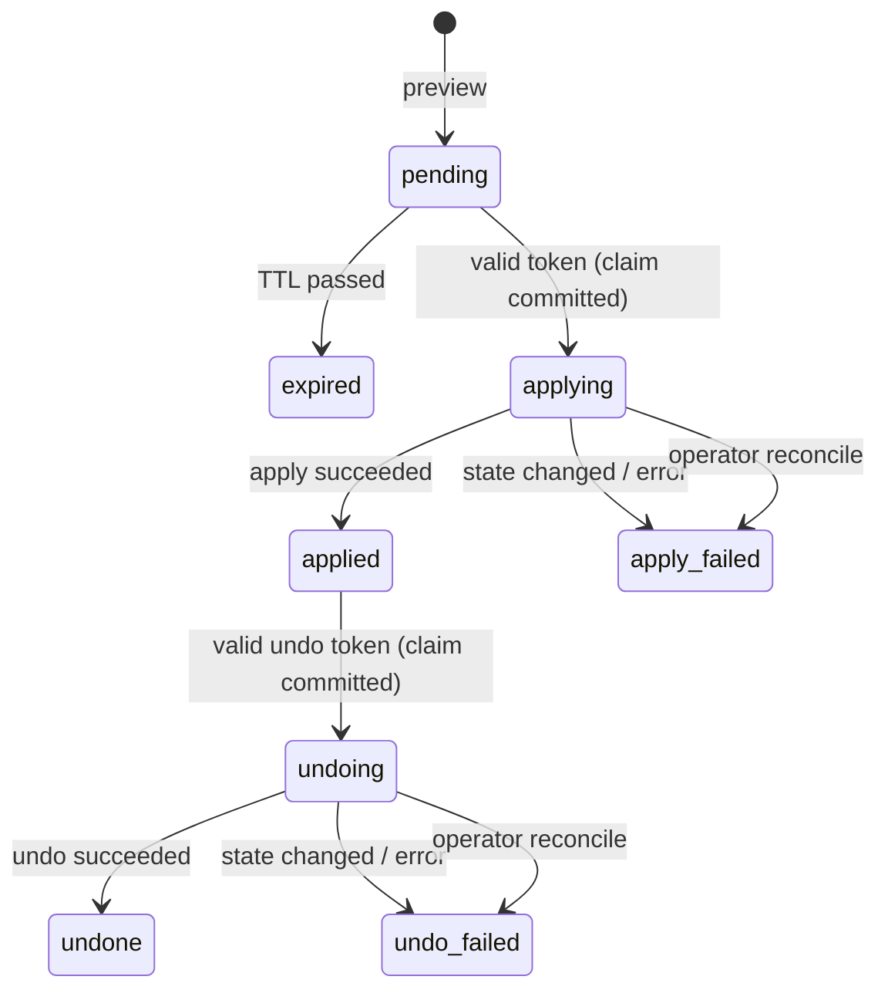

# Security model: tokens, single use and the ledger

This page describes the mechanisms in `src/mcp_changeset/ledger.py` and
`guard.py`, with pointers to the code. For what mcp-changeset does and does
not protect against (actors, threats, non-goals) and how to report a
vulnerability, see [SECURITY.md](../SECURITY.md). Nothing here adds to that
threat model: mcp-changeset limits what an approval can authorize; it does not
authenticate anyone or prove that a person approved anything.

## The flow

```mermaid
sequenceDiagram
    autonumber
    participant A as Agent (untrusted)
    participant S as Server + Guard
    participant L as Ledger (SQLite)
    participant X as Target system

    A->>S: preview_op(args)
    S->>X: observe(payload) (optional)
    S->>L: INSERT pending row: payload, payload_hash,<br/>observed_hash, sha256(confirm token)
    S-->>A: diff, change_id, confirmation_token (returned once)
    Note over A: The diff should be shown to a person.<br/>Alone, mcp-changeset cannot check that it was.
    A->>S: apply_change(change_id, token)
    S->>L: BEGIN IMMEDIATE, check status, TTL, scope,<br/>payload hash, token hash; pending → applying; COMMIT
    S->>X: observe(payload) must match observed_hash
    S->>X: apply(stored payload)
    S->>L: applying → applied, sha256(undo token), after_hash
    S-->>A: result, undo_token (returned once)
    A->>S: undo_change(change_id, undo_token)
    S->>L: BEGIN IMMEDIATE, same checks; applied → undoing; COMMIT
    S->>X: observe(payload) must match after_hash, then undo(payload, result)
    S->>L: undoing → undone
```

`apply_change` and `undo_change` take only a change id and a token. The data
that runs is the payload stored at preview time, so an agent cannot get diff A
approved and then execute B.

## Tokens

| | |
| --- | --- |
| Format | `confirm_` or `undo_` + `secrets.token_urlsafe(24)`: 192 bits from the OS CSPRNG (`ledger.py`, `TOKEN_BYTES`) |
| Returned | once: the confirmation token by the preview, the undo token by a successful apply |
| Stored | never in plain text; only `sha256(purpose ‖ 0x00 ‖ change_id ‖ 0x00 ‖ payload_hash ‖ 0x00 ‖ token)` (`_token_hash`) |
| Compared | `hmac.compare_digest` against the stored hash |
| Expiry | confirmation: `ttl`, default 900 s, within `min_ttl`–`max_ttl` (default 60–3600 s); undo: `undo_ttl`, default 86400 s, or `None` for no expiry unless `max_undo_ttl` is set |
| Change ids | `chg_` + `secrets.token_hex(10)`; identifiers, not secrets |

Why each input is in the hash:

* **purpose** (`apply` / `undo`): a confirmation token cannot be used as an
  undo token, or the other way round.
* **change_id**: a token for one change does not work for another.
* **payload_hash**: editing the stored payload *and* its hash in the database
  still invalidates the token, because the token was hashed against the
  original payload hash.

Unsalted SHA-256 is enough here because the tokens are 192-bit random values,
not passwords: there is nothing to brute-force or look up in a table.

## Single use

Each change is one row whose `status` only moves forward:



* Every transition is `UPDATE … WHERE change_id = ? AND status = ?`
  (`_transition`). Nothing ever returns to `pending`.
* The claims that matter, `pending → applying` and `applied → undoing`, run
  inside `BEGIN IMMEDIATE`. SQLite takes the database write lock before the
  row is read, so two threads or processes sharing the file cannot both see
  `pending`. The claim is committed **before** `apply` runs.
* A wrong token raises and rolls back: the change stays `pending`. The right
  token consumes the change whatever happens next, including when `apply`
  fails.
* Turning writes off (`MCP_CHANGESET_WRITE_MODE` not `guarded`) is checked
  before the claim, so it never burns a pending preview.
* This is **at-most-once**, not exactly-once. If the process dies or the call
  is cancelled between the claim and the final transition, the row stays
  `applying` (or `undoing`). Nothing retries it or resets it. Find such rows
  with `mcp-changeset list --status applying` (and `--status undoing`), check
  the target system by hand, then close them with
  `mcp-changeset reconcile ID --note "…" --yes`, which moves them to
  `apply_failed` / `undo_failed` and records the note. They never become
  retryable.
* Ledger transactions run in a worker thread (`anyio.to_thread`). A started
  transaction always commits or rolls back before a cancellation is
  delivered, so a claim is never half-made.

## Checks at claim time

Inside the same `BEGIN IMMEDIATE` transaction (`claim_apply`, `claim_undo`):

1. the status is `pending` (or `applied` with an undo for undo);
2. the TTL (or undo window) has not passed; an expired pending row is marked
   `expired`;
3. the clock is not more than `max_clock_skew` (60 s) *before* the row's
   creation time, which would otherwise stretch a token's life;
4. the `scope` hash matches, if the guard was created with `scope=`;
5. the stored payload still hashes to `payload_hash`;
6. the token hash matches.

## State binding

If an operation has `observe(payload)`, the canonical-JSON SHA-256 of its
return value is stored at preview (`observed_hash`) and compared again after
the claim; a mismatch fails closed as `apply_failed` and nothing is written.
After a successful apply the hash is taken again (`after_hash`) and checked
before undo, so undo refuses to overwrite a later edit.

`observe` narrows the time-of-check/time-of-use window to the gap between one
read and the write; it does not close it. To close it, make `apply` write
conditionally. [`examples/tickets_server.py`](../examples/tickets_server.py)
does this with a row version (`UPDATE … WHERE version = ?`), the same idea as
an HTTP `If-Match` header.

## The ledger file

* One SQLite file, WAL mode, schema version in `PRAGMA user_version`.
* Created with `O_CREAT | O_EXCL | O_NOFOLLOW` and mode `0600`; an existing
  file is re-chmodded `0600`. A symlink at the path is refused. A missing
  parent directory is created `0700`.
* Local disks only: WAL and `BEGIN IMMEDIATE` are not safe on NFS or SMB.

What a row holds:

| Column(s) | Content |
| --- | --- |
| `payload_json`, `payload_hash` | the exact payload `apply` will receive (clear text) and its SHA-256 |
| `diff_json`, `summary` | what the preview showed (clear text) |
| `apply_token_hash`, `undo_token_hash` | token hashes only |
| `observed_hash`, `after_hash` | state hashes from `observe` |
| `scope_hash` | SHA-256 of `scope`, if set |
| `result_json` | what `apply` returned (clear text) |
| `error`, `public_error` | full failure text for operators; the sanitized text agents saw |
| timestamps, `status`, `undoable`, `undo_expires_at` | lifecycle |

Payloads, results and error text are stored in clear text, and rows are not
deleted automatically; `mcp-changeset prune` (or `Ledger.prune`) deletes
finished rows by age. Treat the ledger like any other file that holds the
data your tools change. It is **not tamper-evident**: anyone who can write it
can forge rows.

## What reaches the agent

* Previews return the confirmation token once; apply returns the undo token
  once. Anything that records the MCP session (client logs, transcripts) sees
  them while they are valid.
* `get_change_status` and `guard.status()` never include tokens or hashes.
* Errors from `ChangeError` and its subclasses pass through. Any other
  exception from your `apply`/`undo` is reduced to its type name for the
  agent; the full text goes to the ledger (`guard.record(id).error`).

## The operator CLI

`mcp-changeset --ledger PATH list|show|reconcile|prune|expire` works on the
same file. It prints payloads, results and raw errors, because reconciling
needs them, but never tokens (only their hashes are stored, and those are not
printed). It opens the file with `Ledger(path, create=False)`, which refuses
a missing file or one that is not an mcp-changeset ledger. `reconcile`,
`prune` and `expire` change nothing without `--yes`.
